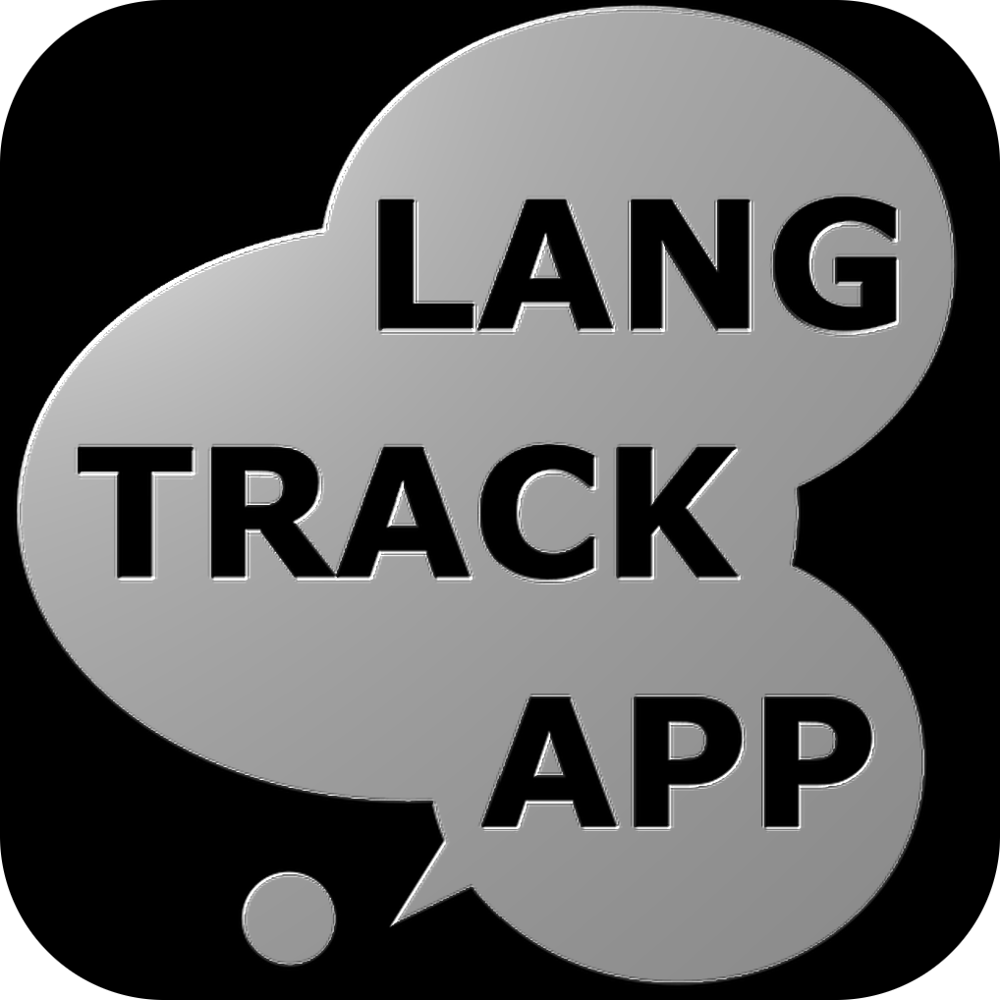

# The LANG-TRACK-APP

#### Table of Contents
1. Project Overview (this document)
2. [Platform Overview](/PlatformOverview.md)
2. [Firebase](/Firebase.md)
3. [Web app, server and database](/LTABackend.md)
4. [Mobile apps](/LTAMobileApps.md)
5. [Example survey](/ExampleSurvey.md)
6. [External backup](/External-backup.md)
7. [Try it](/try-it.md)
8. [Links](#links)
9. [License](#licensing-and-conditions-for-use)
10. [NOTICE](/NOTICE.txt)

#

### Introduction

The Lang-Track-App (LTA) was developed at Lund University to facilitate research project on [Second Language Acquisition](https://en.wikipedia.org/wiki/Second-language_acquisition) (SLA). SLA is the field of research studying the process of learning additional languages in different settings across the lifespan.

Some SLA research targets learners’ interactions with different languages in everyday life and the impact of these interactions on language learning. However, studying exposure to and use of languages in everyday life is a methodological challenge, a challenge that the LTA was specifically designed to address.

The LTA is a native smartphone application running on iOS and on Android platforms, linked to a back-end system. Today, the use of smartphones is widespread and people tend to carry them constantly which makes it possible for researchers to collect data more frequently from participants (in our case language learners) at different moments and in different settings throughout their everyday lives. The combination of the LTA with the [Experience Sampling Method](https://en.wikipedia.org/wiki/Experience_sampling_method) enables researchers to gain a richer understanding of how learners meet and use different languages (cf. Arndt et al., 2021 for discussion).

### Why  develop the LTA?

Principal Investigators (PIs) of research projects need to balance the responsibility to comply with international, national and/or local conditions for data stewardship and data security, the requirements of Open Science, and the flexibility to design research tools to enable addressing specific research questions. There are therefore three main reasons as to why the LTA was developed:

1.  The design of the LTA and the setup of the client-server configuration allow researchers to have extensive control of the dataflow and data processing with minimal involvement of third party providers (including cloud services). The EU [General Data Protection Regulation](https://eur-lex.europa.eu/legal-content/EN/TXT/?qid=1528874672298&uri=CELEX:02016R0679-20160504) (GDPR) requires that data processing is lawful, fair and transparent. According to the GDPR, controllers and processors of data must, under certain circumstances, provide safeguards if data is transferred to a third country or an international organization. Additional national and/or local requirements on data processing and data transfer may also exist. Therefore, the LTA’s design and setup aim to minimize the need of safeguards with respect to reliance on third party providers. The LTA communicates and transfers data to a local server that can be set up in the research environment in accordance with local infrastructure and data safety regulations (see below for details).
    

2.  Sharing the full code for the LTA (including the iOS/Android applications and backend services) with the research community will enable use and adaptations of the tools in the interest of Open Science. Therefore, new iterations of the LTA must be shared by research groups with the aim of securing the long-term sustainability of the tools.
    

3.  By developing the LTA rather than relying on a third party provider of similar services, we also allowed for customised adaptations of the application, data flow and data management specific to the overall project aims and needs. By allowing researchers to control there can be greater flexibility and more time-aligned adaptations than what is otherwise possible.

### Licensing and conditions for use
The code for the LTA mobile applications and backend system was released in 2023 under the [Apache License, Version 2.0.](https://www.apache.org/licenses/LICENSE-2.0.txt). This means that others can use, modify, and distribute the software for any purpose, given proper attribution and disclosure of any significant changes that have been made to the code. New iterations of the LTA must be shared with the aim of securing the long-term sustainability of the tools. When research teams publish their adapted code and/or their own versions of the app on the Google Play / App Store, these should be named along the lines of ‘Lang-Track-App University Name’ (e.g., Lang-Track-App Lund University).  

The following references should be included in any software adaptation, related publications, and inside the app’s About section: 

Arndt, H. L., Granfeldt, J., & Gullberg, M. (2023). The Lang‐Track‐App: Open‐Source Tools for Implementing the Experience Sampling Method in Second Language Acquisition Research. Language Learning, 73(3), 869–903. https://doi.org/10.1111/lang.12555  

Arndt, H.L., Björck, S., Granfeldt, J., Granqvist, J. & Gullberg, M. (2023). The Lang-Track-App (Version #) [mobile and web software]. Lund University Humanities Lab. https://github.com/HumlabLu/HumlabLu  

### Disclaimer
We are happy to share our software for your usage but this is not an off-the-shelf software, nor an actively maintained or publicly supported open source project. Making everything spin up and function for your project is a job of itself, which requires software development and hosting skills. 
This project and these instructions are provided purely for documented reproducibility of research. We are not able to help non-partners with technical support for their projects.
On top of having to be able to complete all the above steps yourself, you may also have to be able to go beyond it, to change features, fix bugs, and correct or adjust mistakes or design decisions or mistakes we have made on the way.
The authors of this project and these instructions are not liable for any errors of method, any losses of data, or anything else you may suffer by following these instructions. 

This project and these instructions may be updated and change over time.
### Links
- [The initial Lang-Track-App research project](https://portal.research.lu.se/portal/en/projects/the-langtrackapp-studying-exposure-to-and-use-of-a-new-language-using-smartphone-technology(4e734940-981f-4dd0-841a-eb6ac760af0c).html)
- [Lund University Humanities Lab](https://www.humlab.lu.se/about/)
- Researchers: [Henriette Arndt](https://portal.research.lu.se/en/persons/henriette-l-arndt), [Jonas Granfeldt](https://portal.research.lu.se/en/persons/jonas-granfelt), [Marianne Gullberg](https://portal.research.lu.se/en/persons/marianne-gullberg)
